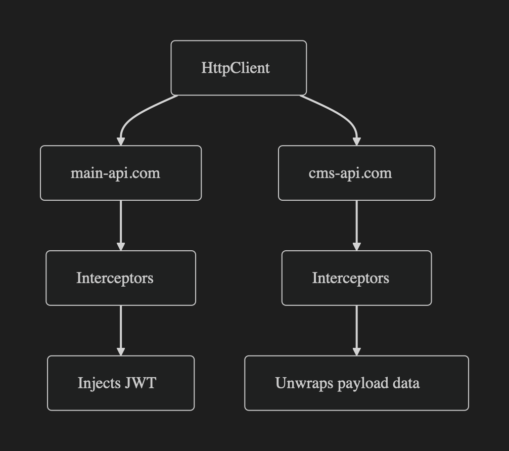

# HttpX

**A better way to fetch http data**

## Why HttpX?

- **Custom Error Handling:**
  Native fetch only rejects a promise during network failures. Extending the Error class ensures that HTTP codes like 404 or 500 throw catchable exceptions containing response context.

- **Response Generics:** Passing a generic parameter allows TypeScript to seamlessly cast `response.json()` into your expected data contract without manually typing `as MyDataType`.

- **Automatic Serialization:** If the request body is a standard JavaScript object, it is automatically stringified, eliminating repetitive `JSON.stringify(data)` calls.

- **Fallback for Empty Responses:** Handles status code 204 No Content to prevent the wrapper from crashing when running `.json()` on an empty body.

- **Per instance `request` `response` and `error`
  interceptors:** By using `this.request`, JavaScript explicitly binds the network execution to whichever specific variable you created. When you instantiate two separate clients, they don't share memory, variables, or configs.

## Getting Started

### Install using your preferred package manager

```bash
bun add @synergy-js/httpx
```

## Examples

**GET Request**

```ts
import { HttpClient } from "@synergy-js/httpx"

interface User {
	id: number
	name: string
	email: string
}

const httpClient = new HttpClient()

const fetchUserData = async () => {
	try {
		// TypeScript automatically knows 'user' is of type 'User'
		const user = await httpClient.get<User>("https://example.com")
		console.log(user.name);
	}
	catch(error) {
		if(error instanceof HttpError) {
			console.error(`Error status: ${error.status}`) // e.g., 404
		}
		else {
			console.error("Network or parsing error occurred")
		}
	}
};
```

**POST Request**

```ts
import { HttpClient, type HttpError } from "@synergy-js/httpx"

interface User {
	id: number
	name: string
	email: string
}

const httpClient = new HttpClient()

const fetchUserData = async () => {
	try {
		// Creating a user with automatic object serialization
		const newUser = await httpClient.post<User>("https://example.com", {
			name: "Jane Doe",
			email: "jane@example.com",
		})
	}
	catch(error) {
		if(error instanceof HttpError) {
			console.error(`Error status: ${error.status}`) // e.g., 404
		}
		else {
			console.error("Network or parsing error occurred")
		}
	}
}
```

**Request Scoped Interceptors**



```ts
import { HttpClient } from "@synergy-js/httpx"

export const mainApi = new HttpClient("https://mainApi.com")
export const cmsApi = new HttpClient("https://cmsApi.com")

// Adding an interceptor ONLY modifies the "mainApi" object box
mainApi.interceptors.request = (options) => {
	options.headers = {
		...(options.headers || {}),
		"X-Custom-Client-ID": "api-testing",
	}
	return options
}
```

**Error Handling**

```ts
import { HttpClient, type HttpError } from "@synergy-js/httpx"

const apiClient = new HttpClient("https://my-other-api.com")
/*
 If the server returns a 4xx or 5xx error code, the code skips 
 the response interceptor and jumps straight into the error interceptor.
 */
apiClient.interceptors.error = (error) => {
	// Check if the error is an HttpError and specifically an unauthorized 401
	if(error instanceof HttpError && error.response.status === 401) {
		console.warn("User token is invalid or expired. Redirecting...")
		
		localStorage.clear()
		window.location.href = "/login" // Instantly kicks them out
		
		return // Stop execution
	}
	
	// If it's a regular error (like a 500), let the component handle it locally
	throw error
};
```
